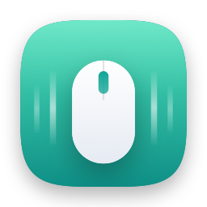

<p align="center"></p>

# SmoothWheel

A free, open-source menu bar app for macOS that makes a notched mouse wheel scroll smoothly, like a trackpad.

It was built for the Logitech Signature M750 and should work with any mouse that has a notched scroll wheel. Trackpads and the Magic Mouse are left alone.

## How it works

SmoothWheel watches scroll events. When one comes from a mouse wheel, it swallows it and replays it as a short animation of trackpad-style pixel scrolls:

- Each notch moves a fixed step (100 px by default), eased in and out over 400 ms. Notches that overlap add together, so a spinning wheel becomes one continuous glide.
- Spinning faster gives bigger steps (up to 3× by default).
- When the wheel stops, the leftover glide is cut short to a configurable stop time.

Trackpad and Magic Mouse scrolls are recognized by their gesture phases and pass through untouched.

## Requirements

- macOS 15 or later
- The Xcode Command Line Tools, to build it. If you don't have them, install them with:

```bash
xcode-select --install
```

## Install

```bash
git clone https://github.com/hloog0/SmoothWheel.git
cd SmoothWheel
./build.sh
```

`build.sh` builds the app, installs it to `~/Applications/SmoothWheel.app` and launches it.

On first launch, macOS asks you to grant **Accessibility** access: System Settings → Privacy & Security → Accessibility → turn on SmoothWheel. SmoothWheel picks it up within a couple of seconds, so there's no need to relaunch.

### Keeping the permission across updates (optional)

macOS remembers Accessibility permission per code signature. Without a signing certificate, every build looks like a new app and you'll need to re-enable it after each update. To avoid that, run this once before `./build.sh`:

```bash
./scripts/make-signing-cert.sh
```

It creates a private, self-signed certificate called "SmoothWheel Local" in your login keychain, and `build.sh` signs with it from then on.

## Using it

Click the mouse icon in the menu bar:

- **Smooth scrolling**: turn it on or off
- **Glide after you stop**: how quickly scrolling settles once the wheel stops, from Short to Full
- **Off in _App_**: turn smoothing off for the app you're in
- **Launch at login**
- **More Settings…**: step size, animation time, acceleration, Shift + wheel for sideways scrolling, a list of excluded apps, and a box to try it out

## Privacy

SmoothWheel needs Accessibility access because that's the only way macOS allows an app to intercept and replace scroll events.

- It only listens to scroll-wheel events, never keystrokes or clicks.
- It records, stores and sends nothing. It makes no network connections.
- It has an optional debug log for tuning, which stays off unless you launch it with `SMOOTHWHEEL_LOG=1`. The log contains scroll timings only and is written to a file you choose.

## Troubleshooting

- **Scrolling feels doubled or floaty**: if your mouse software (for example Logi Options+) has its own smooth scrolling option, turn that off.
- **Smoothing stopped after an update**: re-enable SmoothWheel in Privacy & Security → Accessibility. You may need to remove it with **−** and add it again with **+**. Or set up the signing certificate above so this doesn't happen again.
- **Not running after a restart**: turn on **Launch at login**.

## Uninstall

1. Quit SmoothWheel from its menu bar panel.
2. Remove it from System Settings → Privacy & Security → Accessibility.
3. Delete the app and its settings:

```bash
rm -rf ~/Applications/SmoothWheel.app
defaults delete com.steve.smoothwheel
```

4. If you created the signing certificate, delete "SmoothWheel Local" in Keychain Access (login keychain → My Certificates).

## Development

```bash
./test.sh    # unit tests
open --env SMOOTHWHEEL_LOG=1 --stderr /tmp/smoothwheel.log ~/Applications/SmoothWheel.app    # run with the debug log
```

Use `./test.sh` rather than plain `swift test`. With only the Command Line Tools installed, SwiftPM sometimes can't find Swift Testing's macro plugin and reports `plugin for module 'TestingMacros' not found`, which hides real compile errors. The script loads the plugin explicitly.

| Path | What |
| --- | --- |
| `Sources/SmoothWheelCore/Smoother.swift` | Per-notch easing, overlap, braking after the wheel stops, and acceleration |
| `Sources/SmoothWheelCore/WheelEvents.swift` | Telling wheel events from trackpad gestures; building the replacement scrolls |
| `Sources/SmoothWheel/ScrollTap.swift` | The event tap (needs Accessibility) |
| `Sources/SmoothWheel/ScrollEngine.swift` | Display-synced frame loop that posts the scrolls |
| `Sources/SmoothWheel/AppController.swift` | Ties settings, exclusions and logging together |
| `Sources/SmoothWheel/SmoothWheelApp.swift` | Menu bar panel |
| `Sources/SmoothWheel/SettingsView.swift` | Settings window |
| `scripts/make-icon.swift` | Draws the app icon; regenerate with `swift scripts/make-icon.swift` |

## Disclaimer

SmoothWheel is an independent project. It isn't affiliated with, endorsed by or sponsored by Logitech or Apple. Logitech, Logi Options+, M750, macOS and Magic Mouse are trademarks of their respective owners and are used here only to describe compatibility.

The software is provided "as is", without warranty of any kind. See [LICENSE](LICENSE).

## License

[MIT](LICENSE) © 2026 Steve Liang
